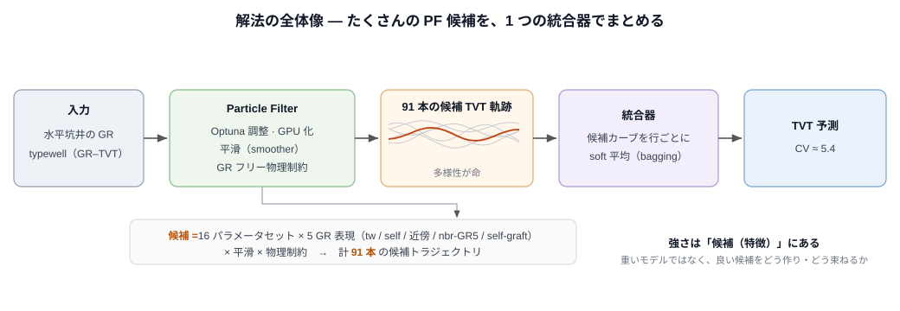
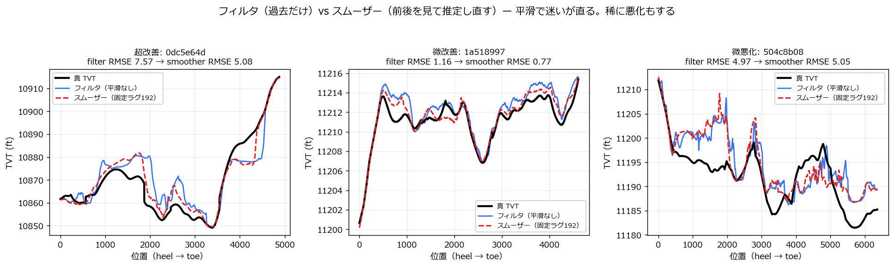
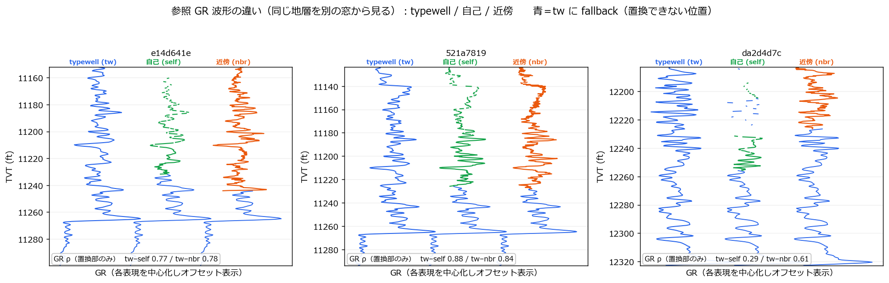
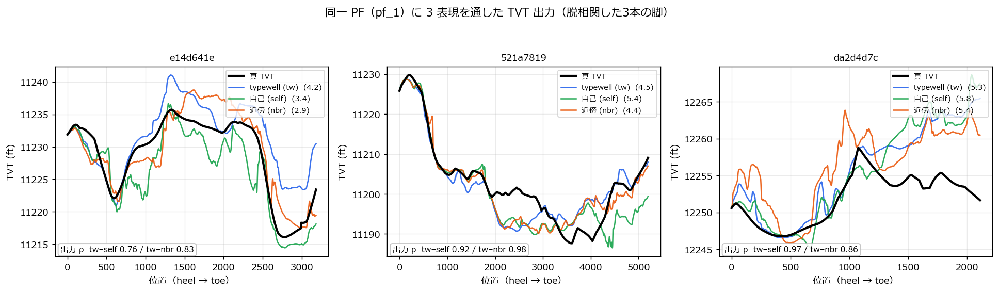
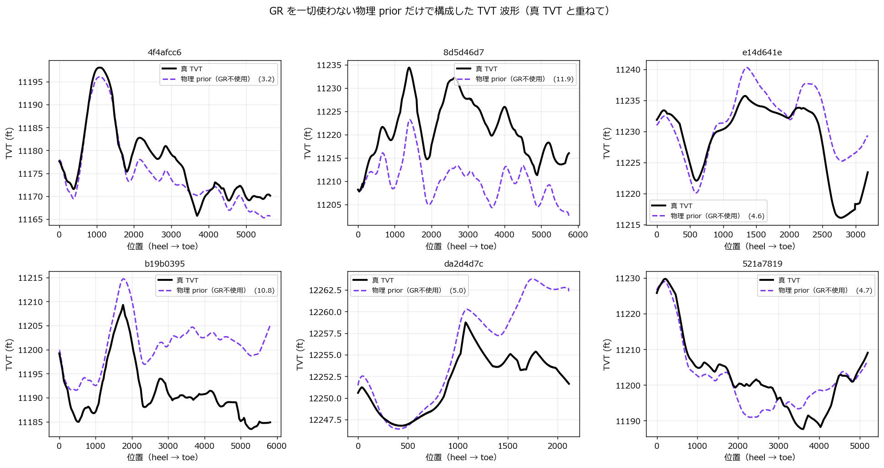
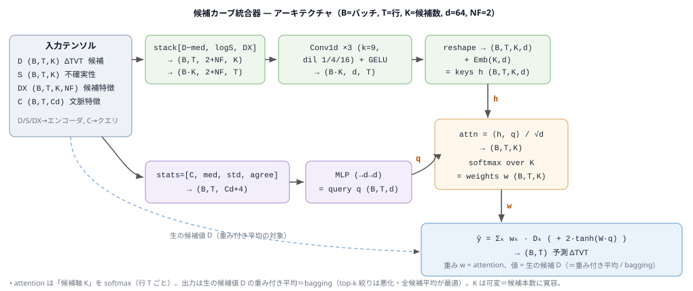
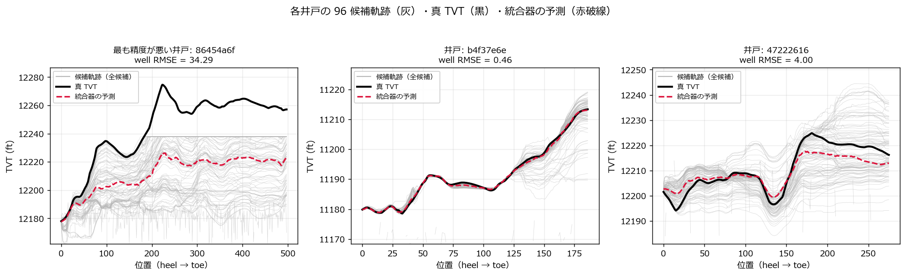

# 【6th Place】Diverse GR Representations × 91 PFs × Row-level Bagging

主催者の皆様、素晴らしい大会を開催していただきありがとうございました。今回のコンペはほとんど開拓されていない領域で、私自身、地質学や時系列データ分析に精通しているわけではありませんが、学べることが多くありました。結果は **Public 20 位 / Private 6 位**と大幅な Shake-up になり、この大きな順位変動が起きた原因についても考察しています。精度の改善の流れに沿って解法を紹介していますので、ぜひご覧ください。他の参加者の皆さんの解法を読むのも楽しみにしております。

## 1. 要約

このタスクは、水平坑井に沿って測ったガンマ線ログ（GR）を、別に用意された基準データに照らし合わせて、その坑井が地層のどの高さを通っているか（TVT）を当てるものです。

私の解法は、最初から最後まで **Particle Filter（粒子フィルタ）** に頼り続けたものです。設定の違う粒子フィルタを何本も走らせて TVT の推定をたくさん作り、**最終的に 91 本の推定を NN モデルに入力**して予測値を得ました。イメージとしては、**NN が行ごとに 91 本の候補を束ねる＝「行レベルのバギング」をしている**、と捉えてもらえれば近いです。CV 5.4 程度まで至れます。私はモデルの専門家ではないので、モデルを凝るのではなく、この「入力する 91 本（＝特徴量）」の方をひたすら良くしていく、という戦い方をしました。

**最終スコアは Private 5.984 / Public 5.626 / CV 5.4577** でした。

---

## 2. 手法と結果

### 2-0. 出発点

私が参加したのは締切の 2 か月前です。公開ノートブックの状況を見て、**Particle Filter と Tabular モデルの組み合わせ**がベースになっていることを確認しました。同時に、これらのノートブックには問題があること（**Public に大きく過学習している**こと）にも気づいていました。

Particle Filter には設定できるパラメータがいくつもあります。[この議論](https://www.kaggle.com/competitions/rogii-wellbore-geology-prediction/discussion/707613)で、**Particle Filter 単体でもかなりの高精度が出る**こと、そして**公開ノートブックはチューニングが足りていない**ことが確認できました。パラメータを Optuna で正しくチューニングするのが、私の第一歩でした。ここから先の改善は、一貫して Particle Filter の改善に大きく依存しています。

### 2-1. ベースライン — CV 7.8 / LB 7.168

Optuna で調整した項目は下の表の通りです。この段階では**物理的なものは一切含まれていません**。また、**粒子のシード数は n_seed=32 に固定**しています。

| パラメータ | 役割 |
|---|---|
| gr_sig（GR尤度σ） | GR 一致度の許容幅（貼り合わせの厳しさ） |
| gr_power | GR 尤度の鋭さ（指数） |
| init_pos_std | 初期 TVT 位置のばらつき |
| init_rate_std | 初期の傾き（変化率）のばらつき |
| mom / vn / pn | 傾きの慣性・遷移ノイズ（位置/傾きのランダムウォーク幅） |
| resamp | 再サンプル閾値（粒子の縮退を防ぐ） |
| jump_prob / jump_std | 別の解（枝）へ跳ぶ確率とその幅 |
| rate_clip / tvt_clip_margin | 傾き・位置ドリフトの制限 |

まず単純に、Optuna で調整した**単一の**パラメータだけを変更し、公開ノートブックと同じように入力しました。結果は CV 8.64 / LB 7.862。LB への過学習ではあるものの、当時の Public ノートブックよりは良い結果でした。

次に、**複数の Particle Filter パラメータから得られる推定を単純結合して入力したらどうか？** という実験を行いました。3 つ入力と 5 つ入力（この 2 つは別物です）を試し、CV・LB ともに改善が得られました。

| 構成 | CV | Public | Δ(Pub−CV) | Private |
|---|---:|---:|---:|---:|
| 1 入力 | 8.64 | 7.862 | −0.78 | 8.163 |
| 3 入力 | 7.90 | 7.189 | −0.71 | 7.729 |
| 5 入力 | 7.80 | 7.168 | −0.63 | 7.804 |

### 2-2. Particle Filter の改造（GPU 化と平滑機構）— CV 7.5 / LB 6.724

2-1 の段階では、3 本の PF（seed=32）を回すだけで採点に 4 時間程度かかっていました。これは Particle Filter の処理に大きく依存していました。そこで **Particle Filter を GPU 駆動のもの**に作り替えました。これにより実験・推論が **約 200 倍**速くなり、試行回数を大きく増やせました。

この改造の副産物として、PF に **smoother（平滑）機構**を組み込めるようになりました。通常の粒子フィルタは「過去の観測だけ」を使って各時点の位置を推定します（因果的）。一方 smoother は、**粒子の系譜（どの粒子がどこから来たか）を保持し、少し先の未来の GR まで見てから過去を推定し直す**仕組みです。前後両方の GR 文脈が使えるので推定が安定し、特に一時的にノイズで迷った箇所が後から修正されます。ここで使っているのは**固定ラグ（fixed-lag）粒子スムーザー**で、Kitagawa (1996) / Doucet & Johansen (2009) に基づきます（末尾の参考文献）。

これを適用して Tabular に入力すると、**平滑幅 smooth=192 のとき CV −0.3 / LB −0.4** の効果が得られました。ただし **平滑ラグを長く取るほど、各粒子の系譜を長区間保持するぶん計算が重くなり、素の PF（平滑なし）より遅くなります**。RTX 5070 で 773 井を 1 パス（1 パラメータ × tw 表現）まわした実測では、**素PF 約 4.5 分 → 固定ラグ 16 約 4.9 分（＋約 1 割）→ 固定ラグ 192 約 13 分（素PF比 約 2.9 倍）**。短いラグはほぼ無料ですが、ラグを 192 まで伸ばすと明確に重くなります（GPU 化していなければ非現実的です）。

| 構成 | CV | Public | Δ(Pub−CV) | Private |
|---|---:|---:|---:|---:|
| 5 入力 | 7.80 | 7.168 | −0.63 | 7.804 |
| 5 入力 + smooth | 7.50 | 6.724 | −0.78 | 7.404 |

上は pf_1（tw 表現）を、平滑なし（フィルタ）と固定ラグ 192（スムーザー）で走らせ、坑井別 RMSE の差から 3 例を選んだものです。**左＝超改善**：フィルタが前半で迷って上振れしている箇所を、前後の GR 文脈を使うスムーザーが引き戻しています（7.57 → 5.08）。**中＝微改善**：もともと素直な坑井では効果は小さいものの確実に改善（1.16 → 0.77）。**右＝微悪化**：ごく稀に、平滑がわずかに悪化させることもあります（4.97 → 5.05）。全体では、迷いを直す効果が上回ります。

### 2-3. GR の別表現（self / neighbor）— CV 6.98 / LB 6.026

[このディスカッション](https://www.kaggle.com/competitions/rogii-wellbore-geology-prediction/discussion/698825)で、typewell の GR（以後 **twGR** と呼称します）にはノイズがあること、そして「**疑似 typewell**」という考え方があることを把握しました。

これを今回のタスクにどう適用できるか考えたとき、**近傍の train 井戸が与えられている**ことに気づきました（**neighbor** と呼称します）。距離が 1500ft 以下の train 近傍井戸の既知 GR を twGR に上書きすることで、疑似的な typewell GR を作れます（**nbrGR** と呼称します）。

同じ考え方をするものがもう一つあり、**self** という考え方です。自井戸の事前区間（ヒール側の既知区間）を用います。そこは TVT・GR がともに既知なので、これも同様に上書きしてしまいます（**selfGR** と呼称します）。

これらの tvt–GR によって推論した結果は、twGR で推論した結果と**大きな相補性**があります。相関はおおよそ twGR に対し selfGR ≈ 0.79、nbrGR ≈ 0.72 程度で、精度は保ちつつ十分に脱相関しています。参照が違えば「間違え方」が違うので、独立した誤差が後段で打ち消し合うわけです。

上は、同じ坑井を twGR / selfGR / nbrGR の 3 通りの参照で見たときの GR 波形です（各表現を中心化し横に並べ、推論対象の TVT 帯 ±64ft にズーム）。self / nbr は「**tw を自分の既知 GR で上書き**」して作りますが、上書きできるのは**自分がデータを持つ TVT 帯だけ**で、それ以外は **tw に戻ります（青＝置換できない位置＝typewell そのもの）**。self（ヒール側の既知区間）は狭い帯しか置換できず、nbr（近傍井）はより広く置換できます。そして、**置き換えた区間だけで tw との相関を取ると 0.3〜0.9 程度**（各パネル左下）——同じ地層でも、別の窓（self / nbr）から見ると GR は実際にそれなりに違う、ということです。

この「置換部の違い」が PF のアライメントを変え、**同じ PF（pf_1）に 3 表現を通す**と、TVT 出力は互いに脱相関した 3 本の脚になります（凡例の括弧内は坑井別 RMSE、左下は出力どうしの相関）。**出力は坑井平均で twGR に対し selfGR ≈ 0.79 / nbrGR ≈ 0.72 まで脱相関**します（相関は坑井ごとにばらつき、上の易しい 3 例では高めに出ています）。どれも単体で真 TVT を追えていますが、外し方が別方向なので、後段の統合器で誤差が打ち消し合います。

この二つも生成し、推定を 15 個に拡張して Tabular に入力することで、**CV・LB ともに −0.50** の効果が得られました。

| 構成 | CV | Public | Δ(Pub−CV) | Private |
|---|---:|---:|---:|---:|
| 2-2（5 入力 + smooth） | 7.50 | 6.724 | −0.78 | 7.404 |
| 2-2 + selfGR + nbrGR | 6.98 | 6.026 | −0.95 | 7.112 |

### 2-4. 物理的制約項の注入 — CV 6.50 / LB 6.43

この時点で **CV 約 7.0・Public LB 6.0** と大きく乖離していました。ディスカッションの「**物理的制約を組み合わせるべき**」という議論を受け、**GR を一切使わず、坑井の幾何（X, Y, Z）と既知 TVT だけから TVT の事前分布**を構築しました。

考え方はこうです。GR を使わなくても、坑井がどの向きにどれだけ進んだか（幾何）と、周囲の井戸がどう傾いているか（地層の傾き＝dip）が分かれば、TVT がどう変化していくかをある程度は予測できます。各井戸を区間に分けて局所的な傾きを推定し、それを空間的に共有して、傾きを積分することで TVT の軌跡を復元します。ただし **この構築は必ず厳密な out-of-fold で行う必要があります**。評価対象の井戸の情報を傾き場や較正に少しでも混ぜると、CV だけが不当に良くなり、Private で崩れます（shake-down の火種）。

上は、**GR を一切使わず物理 prior だけで構成した TVT 波形**を、真 TVT と重ねたものです（凡例の括弧内は坑井別 RMSE）。**GR に頼らなくても、幾何と近傍の傾きだけで TVT の大局的な起伏をかなり追えている**ことが分かります（よく当たる坑井は 3〜5ft、外す坑井は 10ft 超と、ばらつきはあります）。

この物理事前分布は**単体では弱い（CV 10.1 / LB 10.8）**のですが、**PF の尤度項に注入する**ことで真価を発揮します。物理項を注入する前提で Optuna 調整したパラメータを 2-2 に加えたところ、**CV −0.5 / LB +0.5**。そして**ここで初めて CV と LB が一致しました**。

| 構成 | CV | Public | Δ(Pub−CV) | Private |
|---|---:|---:|---:|---:|
| 物理制約だけ（単体） | 10.1 | 10.8 | +0.70 | 9.342 |
| twGR-prior PF 単体 | 7.8 | 7.88 | +0.08 | 7.78 |
| 2-3（selfGR + nbrGR） | 6.98 | 6.026 | −0.95 | 7.112 |
| 2-3 + prior PF | 6.50 | 6.43 | −0.07 | 6.67 |

実際、この構成は **Private でも正しく転移していること**が確認できます（CV 6.50 / Public 6.43 / Private 6.67）。ここで仮に Public LB の値が悪く見えたとしても、**CV を信じて進むという決断こそが正しい判断だった**ことが分かります。

この「CV と LB が一致した」ことが、本コンペの最大の転換点でした。

### 2-5. 余っていた大量の PF を、入力に寛容な統合器でまとめる — CV 5.94 / LB 6.17

Optuna でチューニングしたものの、**単体では改善につながらなかった PF が大量に余っていました**。ある時、それらを捨てずに**まとめて全部入力してみたところ、精度が大きく跳ね上がり、CV は 6.0 を割りました（CV 5.94 / Public 6.17）**。

なぜ効いたのか。前提として、誤差を解剖すると、強い PF 出力に対する残差の自己相関はほぼ 1.000 で、**行ごとの独立した信号はほぼ枯れていて、誤差は区間（セグメント）ごとの「どちらの解に乗るか」に宿る**ことが分かっていました。問題は行の回帰ではなく、**区間ごとに、たくさんの候補の中からどれに乗るかを決める**ことです。

そこで、**各 PF × 各表現が吐く TVT 軌跡を、それぞれ「1 本の候補カーブ」として並べ、軽量な attention が行ごとに候補を soft に加重平均する「候補カーブ統合器」**を作りました。Tabular は候補を固定長で結合するしかなく**表現力に限界**がありましたが、統合器は**入力する候補を何本でも並べられます**。ここが決定的でした。だからこそ、それまで**単体では効かず余っていた PF たち**をそのまま全部候補として食わせることができ、それが一気に効いたのです。

このとき入れた候補は、**6 本の PF（pf_1 / pf_2 / pf_3 / r0_seed32 / r1_seed32 / pfA）× 5 表現 ＝ 30 本**です。5 表現は「GR を**どのテンプレートに貼り合わせるか**」の違いです：

- **typewell**：与えられた縦坑のテンプレート（2-3）。
- **self**：自分の既知 prefix の GR を疑似テンプレートに（2-3）。
- **neighbor**：XY 空間で近い train 井戸の GR を疑似テンプレートに（2-3）。
- **nbr_gr5**：近傍を「XY 距離」ではなく「**GR が似ている（層序が合う）train 井戸 上位 5 本**」から選んだ版。
- **self_graft**：self の既知範囲の外側を、typewell を self に較正して**外挿（graft）**し、self の効く範囲を広げた版。

**6 本の PF のうち、物理制約（GRフリー錨）付きは pfA の 1 本だけ**でした。

設計上の発見は、**これは「1 本を選ぶ選択器」ではなく「広く soft に平均する＝bagging」として働く**ということです。実際、上位 k 本に絞ると悪化し、全候補を softmax で平均するのが最適でした。GR だけからは「どちらの解が正しいか」を当てられない以上、**無理に選ばず、確率的に平均してヘッジする**のが正解だったわけです。

なお、この段階の最終予測は **GBM（Tabular）＋ 系列ネット（TCN）＋ 統合器 の固定重み 3 脚ブレンド**でした。各脚の単体 CV とブレンド重みは以下の通りです。

| 脚 | 単体 CV | ブレンド重み |
|---|---:|---:|
| GBM（Tabular） | 6.65 | 0.05 |
| 系列ネット（TCN） | 6.32 | 0.51 |
| 候補カーブ統合器 | 6.19 | 0.44 |
| **3 脚ブレンド** | **5.94** | — |

| 構成 | 候補数 | CV | Public | Δ(Pub−CV) | Private |
|---|---:|---:|---:|---:|---:|
| 2-4（Tabular, 15 候補） | 15 | 6.50 | 6.43 | −0.07 | 6.67 |
| 余った PF を統合器へ全部投入 | 30 | 5.94 | 6.17 | +0.23 | 6.382 |

### 2-6. 一段ずつ積み上げて 提出A / 提出B へ（最終形）

CV 5.94 から先は、**脱相関候補を増やす・平滑を強くする**といった工夫を一つ足すたびに、CV も Public も着実に下がっていきました。足した順に並べます。

| 足した工夫 | 候補数 | CV | Public | Δ(Pub−CV) | Private |
|---|---:|---:|---:|---:|---:|
| （2-5 到達点） | 30 | 5.94 | 6.17 | +0.23 | 6.382 |
| ① 特徴結合で 1 モデル再学習 | 46 | 5.75 | 5.707 | −0.04 | 6.166 |
| ② 固定ラグ平滑 → full 平滑 | 46 | 5.70 | 5.652 | −0.05 | 6.097 |
| ③ 脱相関 PF を +5（**提出A**） | 71 | 5.587 | **5.458** | −0.13 | 5.997 |
| ④ dec10 / tw-affine を追加（**提出B**） | 91 | 5.458 | 5.626 | +0.17 | **5.984** |

**① 特徴結合 ＞ アンサンブル。** 別々に作ったモデルを後段で混ぜるより、**特徴（候補）を結合して 1 つのモデルを再学習**する方が 2.6 倍効きました。統合器の強さは「候補の質 × 多様性」で決まるので、混ぜるより結合が本筋です。

**② full 平滑。** 2-2 の固定ラグ平滑を、全区間を使う平滑に置き換えました（固定ラグを系列長まで広げた ancestral smoother。同じく Kitagawa 1996 / Doucet & Johansen 2009 の系列、全区間版は path degeneracy に注意）。統合器が候補の質向上を素直に享受し、**CV −0.043 がそのまま Public へ完全転移**しました。

**③ 脱相関 PF の積み上げ（提出A）。** 錨（物理制約）なし・emission なしで別々にチューニングした PF を 5 本足し、候補を 46 → 71 に増やしました。**CV 5.70 → 5.587、Public 5.637 → 5.458 と、CV 以上に好転移（−0.18）**。ここが本命で、重要なのは **単体で弱くても「間違え方が別方向にずれた」候補だけが効く**こと。既存と相関 0.99 の候補はいくら足しても無駄でした。

**④ dec10 / tw-affine（提出B）。** さらに dec10（MD 方向に間引いてノイズを均した PF）と tw-affine（prefix で GR を較正した PF）を足し、候補を 91 本に。**CV 5.4577 / Public 5.626**。

**後処理（de-shrink）。** 提出A・提出B とも、統合器のブレンド予測に最後の一手として **global gain a≈1.03 の 1 パラメータ較正**を掛けています。統合器は候補の重み付き平均（＝soft 平均）なので、予測の振幅が真値よりわずかに縮みます。これを大域ゲインで戻すもので、**CV −0.015 程度**の小さな上乗せですが、**1 パラメータの大域補正なので過学習しにくく転移も堅い**です。井戸レベルの定数シフト後処理が LB で逆噴射した（§3-2・§5）のとは対照的です。

逆に、統合器そのものを強くする方向（cross-attention 化、候補間の関係注入、外部脚の候補注入）は**すべて本体と相関 ~0.99 で飽和**し、単体では微増でもアンサンブルには一切載りませんでした。伸びしろは常に「別の情報源から来る脱相関な候補」だけだった、というのが最終的な結論です。

最後に、最終候補群を 3 井戸で可視化します（灰＝全候補軌跡、黒＝真 TVT、赤破線＝統合器の予測）。

**左＝最も精度が悪い井戸**：真 TVT が全候補の上に外れており、datum の枝を全候補が取り違えています。統合器は候補の重み付き平均なので、候補群が真値を囲めていない硬い井戸では**原理的に届きません**（これが 2-4・§3-2 の datum 壁の正体）。**中・右＝ランダム 2 井戸**：候補が真値を囲めていれば統合器はよく当たります。

---

## 3. 考察

### 3-1. 精度が上がった大きな要因

精度が伸びた最大の要因は、**PF の出力そのものが大きな多様性を持っていた**ことだと考えています。

具体的には、**物理 prior（GR フリー制約）を入れた軌跡と入れない軌跡**、照合先が **typewell か・そうではない近傍の井戸か**、あるいは **事前区間（prefix）由来の軌跡**、さらに **full 平滑による全体的な精度の底上げ**。こうして **思いつくものを片っ端から全部** PF に通しました。その結果、**PF だけで大きな多様性**が生まれています。一つ一つの候補の精度は overall RMSE で **10.0〜7.8 程度**と、単体では決して強くありません。

端的にやっていることは **大量の PF 出力のバギング**です。しかし、**"特性の違う" 候補を並べて束ねるだけで、ここまで精度が上がりました**。その良い実例になったと思います。

### 3-2. Public LB の偏りと、CV / Public / Private の転移

私は過去にディスカッションで「**Public は、ある条件で過適合する**」と述べました。私の考えでは、**GR の一致度だけに依存する方法は Public に過適合してしまう**、ということです。

下の表は、物理制約を加えたときと加えていないときの結果です。**GR だけに依存する方法（物理なし）は、CV から Public へ大きく“正”に転移**しています（Public が CV よりずっと良く見える）。一方、**物理制約を加えると、Public も Private も CV に従って揃う**（転移が素直になる）傾向が見えます。

| 構成 | CV | Public | Δ(Pub−CV) | Private | 転移の傾向 |
|---|---:|---:|---:|---:|---|
| 5 入力 + smooth（GRのみ） | 7.50 | 6.724 | −0.78 | 7.404 | Public が大きく良い＝GR過適合 |
| self + nbr（GRのみ） | 6.98 | 6.026 | −0.95 | 7.112 | 同上（CV≫Public） |
| + 物理制約 prior | 6.50 | 6.43 | −0.07 | 6.67 | **CV ≒ Public ≒ Private で揃う** |

そして、これは **Private の最終結果でも裏付けられました**。最終 2 つの順位を並べると、**CV は 提出B < 提出A**（提出B が良い）、**Public は 提出A < 提出B**（逆）、そして **Private は 提出B(5.984) < 提出A(5.997)＝ CV と一致**。つまり CV は正しく「向き」を予測しており、**提出A を上に見せた Public LB こそが唯一の外れ値**でした。提出B で加えた PF構成は Public では過学習に“見えた”だけで、より代表的で難しい Private では、CV が言った通り実際に少し良かったのです。

### 3-3. Shake-down を起こしやすい「物理的制約の作り方」

2-4 の物理制約は非常に強力ですが、**作り方を誤ると簡単に Public/CV へ過学習し、Private で大きく崩れる（shake-down する）**危険があります。ここが最重要の工夫です。

物理制約は「井戸の傾き場」と「その較正係数」を、他の井戸の情報から作ります。このとき、**評価する井戸（validation）の情報を、傾き場や較正の構築に少しでも混ぜてしまうと、答えを覗き見た状態になり、CV だけが不当に良くなります**。そうなると CV–LB の転移を正しく観測できず、Public 順位を信じて選んだ提出が Private で崩れます。

対策は、**必ず厳密な 5-fold（out-of-fold）で構築する**こと。すなわち、傾き場・較正係数・近傍プールを、**その fold の学習側の井戸だけ**から作り、評価側の井戸を完全に除外して予測する。fold ごとに場も較正も作り直します。私の目的は「CV を信頼できる指標に育てる」ことだったので、この厳密さは決定的でした。物理制約のように「学習して作る事前分布」を入れるときは、**リーク＝shake の火種**だと考えて、評価対象を必ず外して作るべきです。

### 3-4. 行ごとの回帰（Tabular 単体）が機能しない理由

序盤は Tabular（GBDT）が主役でしたが、精度が上がるにつれて系列モデル＋候補選択に完全に置き換わりました。理由は本質的です。

一言でいうと、**「1 行ずつの回帰」では解けない問題だった**からです。強い PF の出力に対して、残っている誤差はもう「1 行ずつの細かいズレ」ではなく、**ある区間まるごとが、上か下かのどちらかに丸ごとずれている**、という形をしています。GR は地層の周期性のせいで、上と下の 2 か所でほとんど同じに見えてしまうため、「この区間は上か下か」を GR から当てることは、ほぼコイン投げ（当たらない）でした。

1 行ずつの特徴量には「この区間全体が、どちらの解に乗っているか」という情報が入りません。だから Tabular はどれだけ特徴を足しても頭打ちになります。逆に、PF が出す「1 本の首尾一貫した軌跡」を候補として並べ、それを soft に平均する方式は、この「区間まるごとの選択」を自然に表現できました。要するに、**Tabular が悪いのではなく、問題の形（区間まるごとの二択）に、行ごとの回帰という枠組みが合っていなかった**、ということです。

### 3-5. Private で shake-down を起こさないための CV 設計

shake-down を避けるうえで私が最も重視したのは、**fold 間の分散を小さくする**ことです。

理由は、**Train / Public / Private は完全にランダムに分けられている可能性が高く**、しかも **それぞれ 150 井程度と少ない**からです。井戸数の少ないランダム分割では、どの分割でも **たまたま難しい井戸が偏って入り、下振れを引いてしまう**可能性が常につきまといます。Public や Private が「たまたま悪い引き」になること自体は、こちらでは避けられません。

だからこそ、**どの fold・どの分割でも成績が大きく崩れない＝下振れが起きない設計**が効いてきます。fold 間の分散が小さいモデルなら、Public / Private がどんなランダム 150 井の引きであっても大きくは外しません。逆に、平均性能が同じでも fold 間分散が大きいモデルは、どこかで下振れを引いて shake-down する危険を常に抱えます。**「平均を上げる」ことと同じくらい、「下振れを無くす」ことが大事**だ、というのが私の結論です。

実際、最終提出で測ると、**5 分割それぞれ（各 155 井）の RMSE はおおむね 4〜6.7 に収まり、5 分割を平均した overall CV は分割を切り直しても 5.40〜5.43（std ≈ 0.015）とほとんど動きません**。序盤（2-1）のベースラインでは fold ごとに 6〜10 と大きく振れていたので、**fold 間のばらつきは大きく縮んでいます**。この「下振れの起きにくさ」が、Private でも崩れなかった一因だと考えています。

### 3-6. Optuna でチューニングした PF パラメータは、なぜ CV に過適合しなかったのか

PF のパラメータは、773 井から**ランダムに 600 井（あるいは 150 井）を選んで**チューニングしていました。「そんな選び方をすれば、選んだ井戸に過適合するのでは？」という懸念は当然あります。

まず、**PF は決定論的な手法で、パラメータ数も多くない**ため、そもそも過適合を起こしにくい性質があります。とはいえ、**少ない井戸で最適化した場合には、実際に過適合が起きていることを確認しました**。

ただし、その過適合は **twGR（typewell の GR に照合する表現）に対してだけ**起きていると考えられます。私はチューニングを twGR で行い、そこで得たパラメータを **nbrGR / selfGR など別の表現（2-3）にもそのまま転用**していました。**twGR に過適合したパラメータを、素性の違う別表現へ流用したことで、過適合が薄まった**のではないか、と考えています。

### 3-7. Shake-up が起きた理由

金メダル圏内が大きく入れ替わったのは、Public に過適合したことが原因ではありません。**CV と Public にとっては優秀であるが、Private ではいまいち振るわない手法が存在した**ために、この入れ替わりは起きています。シェイクダウンによって順位が入れ替わってしまった彼らの手法こそ、価値のある方法だと私は考えています。**公開ノートブックの過適合と一緒ではありません。同列に考えないであげてください。**

最終順位では大きな shake-up が起き、Public 上位の多くが入れ替わりました。上位に残った解法を見る限り、**HMM や Particle Filter といった物理モデルに依拠したチームが軒並み順位を上げています**。これが単なる分割ノイズなのか、意図的に別のドメイン（＝物理モデル寄りの定式化）を選んだ結果なのかは断定できませんが、少なくとも **Public 上位群と Private 上位群とでは、支配的な解法のドメインが大きく異なっていた**のは確かです。

大会終了後に別のチームと少し話す機会があり、そこで **「物理モデルに依存しない解き方では、CV 過学習が起こりやすいのではないか」** という指摘を受けました。

そう考えると、**私が shake-up 側（＝順位を上げた側）に回れたのは、幸運も大きかった**と思います。Public 上位で物理モデルに強く依存していなかった解法は、手法そのものとしては優れていたとしても、**Private でのドメインシフトによる精度低下を避けられなかった**のだろう、というのが私の見立てです。

---

## 4. 効いた手法

改善の理由になった方法を列挙します。

- **Particle Filter のパラメータを Optuna で最適化**（GR 尤度σ・遷移ノイズ・resample・jump など）。良い候補を作る土台。
- **複数パラメータ PF の推定を結合して入力**（3 入力・5 入力で段階的に改善）。
- **PF の GPU 化**（約 60 倍高速化）＝試行回数を稼ぎ、平滑機構を可能にした。
- **平滑（smoother）機構**。前後の GR 文脈で推定を安定化。lag=192 で CV −0.3 / LB −0.4、リークなく素直に転移。
- **GR の別表現を複数追加**（twGR に加え、self・近傍(XY 距離)・GR 類似近傍・self を較正外挿した graft の計 5 表現）。いずれも twGR と脱相関（≈0.7〜0.8）だが精度は保つ相補的な候補。
- **GR を使わない物理制約を PF の尤度に注入**（必ず 5-fold で構築）。CV と LB を一致させ、GR 過依存の Public 甘さを中和。
- **候補を「1 本のカーブ」として soft 平均する統合器**（選択でなくヘッジ）。
- **脱相関な PF構成の積み上げ**（間違え方が別方向の候補だけが効く）＝終盤唯一の伸びしろ。
- **特徴結合 ＞ アンサンブル**（別学習して混ぜるより、結合して再学習）。
- **full 平滑**（全区間の平滑）＝候補の質向上を統合器が完全転移。
- **系列 NN（TCN）残差ブレンド**（弱い土台ほど上乗せ大）。
- **後処理の de-shrink**（平均で縮んだ予測を global gain a≈1.03 の 1 パラメータで戻す）＝**CV 5.587 → 5.572（−0.015）**。1 パラメータの大域補正なので物理的で、転移も堅い。
- **FFBS 系の粒子平滑（Godsill et al. 2004）**。全区間の系譜平滑として**実際に効いた**（候補の質が上がる）。ただし**計算が遅すぎて最終パイプラインには採用せず**、代わりに軽い固定ラグ／全区間平滑で置き換えた。
- **「PF は素・単一に固定、賢さは後段に置く」／推論シードを調整時に揃える**（過学習回避）。

---

## 5. 効かなかった手法

試したが効かなかった／逆効果だったものを、ほぼ全て列挙します。

- **PF パラメータを井戸カテゴリ別に作り込む** → 過学習。単一固定 PF に大差で負ける。
- **PF 出力の素朴平均** → 別々の解に commit したものを平均すると中点に落ちて壊れる。
- **selfGR を「予測」として出力ブレンド** → 既存の後処理と二重計上、非転移で有害（特徴としては有効）。
- **物理制約（空間場）を単体で強化** → CV は下がるが LB では逆噴射（prior 濃度が高いほど転移が悪化）。
- **井戸レベルの定数シフト後処理（vote-hedge 等）** → OOF −0.075 が LB +0.184 と逆噴射。
- **統合器の選択強化（上位 k 絞り / cross-attention 化 / 候補間関係注入 / 外部脚注入）** → すべて本体と相関 ~0.99 で飽和。
- **Tabular（行回帰）単体で解こうとする** → 区間まるごとの二択に枠組みが合わない。
- **PF を一切使わない 2D 画像 CNN（GR 照合像 → U-Net）** → 単体 CV は良いが LB 9.46 と大崩れ。
- **物理制約を Tabular の特徴に焼き込む** → GR 由来の好転移が死ぬ（両者はトレードオフ）。
- **二択を直接当てにいく手法（大域 MAP / Viterbi / 疎なモード切替）** → GR だけでは枝を選べず、効いて見えたのは実は物理制約が効いていただけ。
- **条件付きで予測を既知値へ引き戻す後処理** → 引き戻す対象を選ぶ判定がどれも当たらない。
- **メタ学習で重みを学習** → 手作りの固定重みに全敗。
- **重い系列アーキ（iTransformer / Mamba 系 / 深い TCN / BiGRU）** → 同じ候補の再処理で飽和、速度対効果も悪い。
- **近傍距離を「地層の近さ」の代理にする** → 距離と層序は別物（GR で最良の参照井は中央値 ~5800ft 先）。
- **逆方向データ拡張（井戸を反転した合成タスク）** → 弱いエンジン（序盤）では CV −0.05 が LB −0.16 と好転移したが、最終の強い PF/統合器では効かず、むしろ **+0.2 の悪化（逆転移）** を招いた。エンジンが強くなるほど DA の利得は減衰・逆転する。
- **合成井戸での事前学習** → 効かなかった。ただしこれは**おそらく生成（合成の作り方）が悪かった**ためで、手法自体に見込みがないとは言い切れない。

---

## 6. 補足説明

- **実行環境・計算コスト**：
  - **学習・実験（ローカル）**：GPU = RTX 5070 / CPU = AMD Ryzen 7 7700 / メモリ = 32GB DDR5。PF・NN の学習と全実験はこの 1 台で回しました（本編の実測時間はすべてこの環境）。
  - **提出（Kaggle ノートブック）**：GPU = T4 × 2。ローカルとは GPU 世代・VRAM・数値挙動が異なるため、隠しテストでの OOM や bf16 の math フォールバック等、提出側特有の落とし穴に注意が必要でした。
- **最終提出（提出B）で使った PF パラメータ**：
  提出B の候補群は、**Optuna で個別最適化した 16 個の PF パラメータセット**を、5 つの GR 表現（tw / self / 近傍(XY) / GR 類似近傍 / self-graft）と複数のラグに通して作った計 **91 本**の候補トラジェクトリです（うち tw を prefix affine で再較正した派生列 15 本、MD 間引き版 5 本を含む）。16 セットの主要ノブを下表に示します。
  共通設定は **n_seed = 32・全区間平滑・グリッド刻み 0.2ft**。列の意味は σ_def＝GR 尤度の基準幅、vn/pn＝遷移ノイズ（傾き / 位置）、resamp＝リサンプリング閾値、錨＝GR フリー物理制約の強さ（mult）、emis＝学習類似度 emission の温度 w_nn。

  | バンク | 粒子 | gr_power | σ_def | vn | pn | resamp | jump | 錨 | emis | 役割 |
  |---|--:|--:|--:|--:|--:|--:|--:|:--:|--:|---|
  | pf_1 | 600 | 2.19 | 114 | .0014 | .0068 | .061 | .002 | − | .02 | 元祖 Optuna 群（GR 尤度σ・遷移ノイズを個別最適化） |
  | pf_2 | 600 | 2.00 | 71 | .0011 | .0113 | .308 | − | − | .02 | 〃（狭σ・高resamp） |
  | pf_3 | 600 | 2.07 | 67 | .0007 | .0439 | .055 | .002 | − | .02 | 〃（大pn＝位置ノイズ大） |
  | r0 | 400 | 1.78 | 119 | .0006 | .0050 | .032 | .002 | − | .02 | 別 seed で再チューニング |
  | r1 | 400 | 1.46 | 83 | .0012 | .0028 | .037 | .002 | − | .02 | 〃（緩い尤度 gr_power） |
  | **pfA** | 600 | 1.85 | 87 | .0009 | .0061 | .186 | .002 | **✓20** | .01 | **物理錨（mult20）＋ emission**（CV=LB を揃える柱） |
  | pf_1′ | 800 | 2.99 | 131 | .0009 | .0405 | .053 | − | − | .02 | 別調整の再チューニング群（鋭い尤度 gr_power≈3） |
  | pf_2′ | 500 | 2.08 | 95 | .0010 | .0366 | .064 | .002 | **✓20** | .02 | 〃（物理錨あり） |
  | pf_3′ | 600 | 1.49 | 125 | .0017 | .0028 | .212 | − | − | .02 | 〃（緩い尤度・高resamp） |
  | pf_4′ | 700 | 2.31 | 92 | .0020 | .0107 | .040 | − | **✓20** | .02 | 〃（物理錨あり） |
  | p_1 | 700 | 2.08 | 103 | .0013 | .0078 | .046 | .002 | − | **0** | **錨なし・emission なしの脱相関 5 本**（提出A の本命③）。emission を切ると候補の多様性が保たれ、統合器が最も伸びた |
  | p_2 | 600 | 2.01 | 90 | .0009 | .0015 | .207 | .002 | − | **0** | 〃 |
  | p_3 | 800 | 2.36 | 122 | .0016 | .0086 | .220 | .002 | − | **0** | 〃 |
  | p_4 | 800 | 2.23 | 110 | .0013 | .0044 | .140 | − | − | **0** | 〃 |
  | p_5 | 700 | 2.44 | 88 | .0013 | .0063 | .030 | − | − | **0** | 〃 |
  | dec10 | 600 | 2.19 | 114 | .0014 | .0068 | .061 | .002 | − | .02 | pf_1 のパラメータを **MD ×10 間引き**した GR に適用（ノイズを均した脱相関脚、提出B の④） |

  数値はすべて Optuna で得た実際の設定値です（厳密な全ハイパラは配布コードの `pf_banks_config.json` を参照）。ポイントは **単体性能ではなく "間違え方の方向" を散らすこと**で、そのため σ・gr_power・resample・錨/emission の有無を意図的にばらしています。
- **コード**：コードは後ほど GitHub で共有します。

---

## 7. 終わりに

私の方法は**おそらく他の上位入賞者とはかなり違う**と思います。私にはモデルの深い知識はありません。その代わり、**Particle Filter が生む特徴量の方をひたすら改善し続ける**ことで、ここまでやり切りました。強いモデルを持ち込むのではなく、「良い候補をどう作り、どう統合するか」に集中した、という点で少し変わった解法かもしれません。

主催と Kaggle に感謝します。そしてディスカッションで知見を共有してくださった参加者の皆さんに感謝します。非常に画期的で面白いコンペでした。ありがとうございました。

質問があれば気軽にコメントしてください。できる限りお答えします。

（この記事は Claude と協力して書いたので、不足している点や間違っている点が一部あるかもしれません。）

---

## 参考文献

- N. J. Gordon, D. J. Salmond, A. F. M. Smith (1993). *Novel approach to nonlinear/non-Gaussian Bayesian state estimation.* IEE Proceedings F, 140(2), 107–113. — bootstrap（SIR）粒子フィルタの原典。
- G. Kitagawa (1996). *Monte Carlo Filter and Smoother for Non-Gaussian Nonlinear State Space Models.* Journal of Computational and Graphical Statistics, 5(1), 1–25. — 粒子フィルタ＋（固定ラグ／全区間）粒子スムーザー。本稿の平滑機構の基盤。
- A. Doucet, A. M. Johansen (2009). *A Tutorial on Particle Filtering and Smoothing: Fifteen Years Later.* — 粒子平滑の定番サーベイ（固定ラグ・ancestral 平滑と path degeneracy を含む）。
- S. J. Godsill, A. Doucet, M. West (2004). *Monte Carlo Smoothing for Nonlinear Time Series.* JASA, 99(465), 156–168. — FFBS（本稿「効かなかった手法」で言及）。
